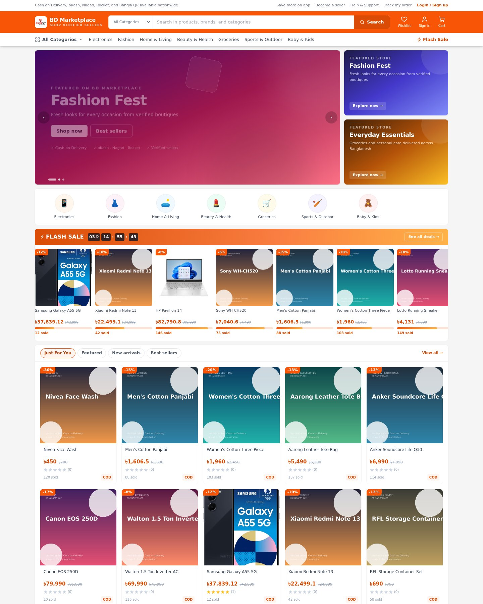
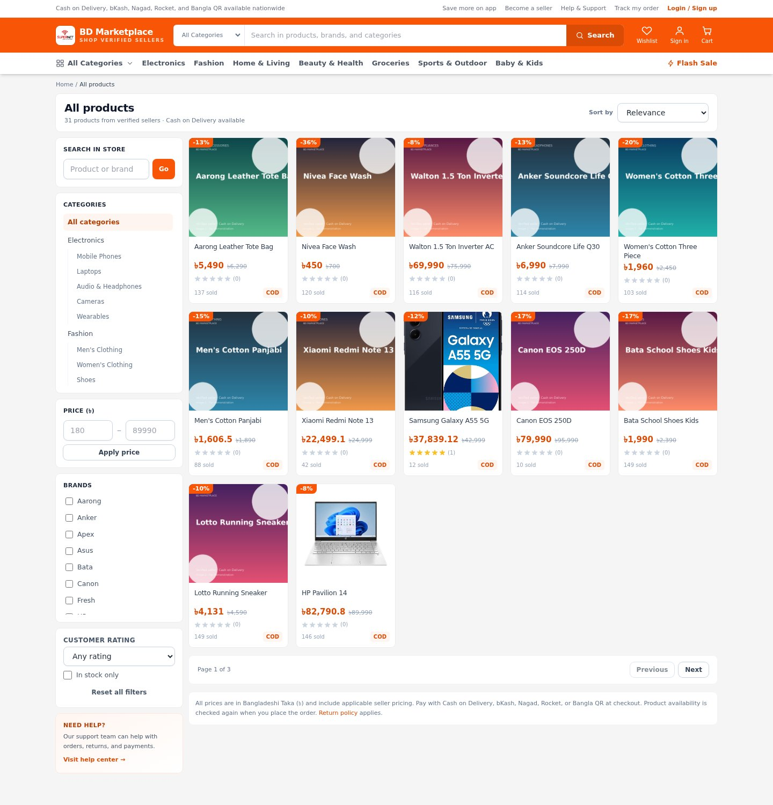
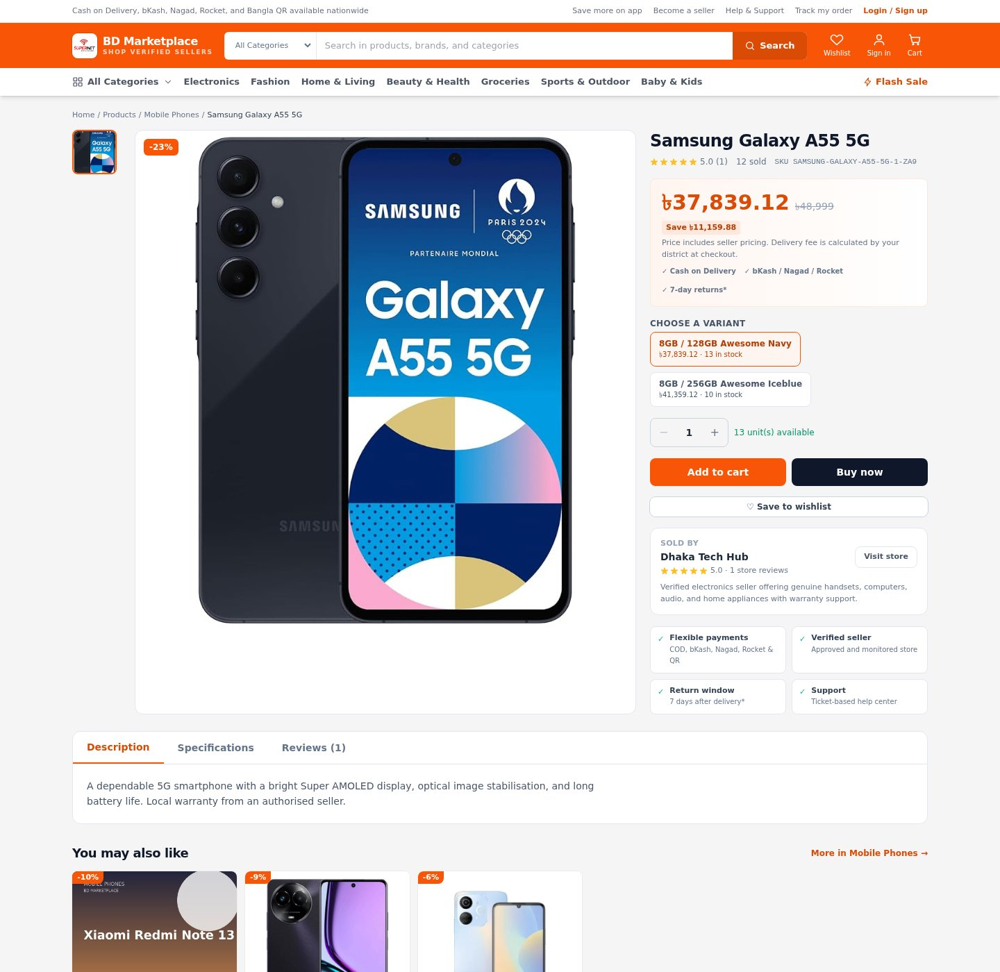
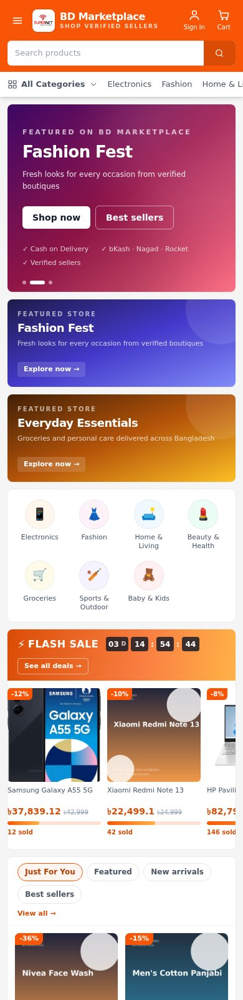

# BD Marketplace

**A complete, self-hosted multi-vendor marketplace for Bangladesh — built with Laravel 12, React 18, TypeScript, and a Daraz-inspired storefront.**

[](https://github.com/johirxofficial/bd-marketplace/actions/workflows/ci.yml)
[](https://www.php.net/)
[](https://laravel.com/)
[](https://react.dev/)
[](https://www.typescriptlang.org/)
[](https://www.mysql.com/)
[](#license)

BD Marketplace gives a Bangladeshi business a full online shop: verified sellers, a
customer storefront, seller centre, admin console, cash-on-delivery and mobile-wallet
payments, receipts, email/SMS notifications, coupons, returns, settlements, and a
plugin/developer API — all in one deployable application.

> **Storefront redesign:** the shop now uses a Daraz-style orange header, mega category
> menu, hero carousel, flash-sale countdown rail, category circles, a five-column
> "Just For You" product feed, wishlist/cart shortcuts, and a mobile-first layout.
> See [screenshots](#screenshots).

---

## Table of contents

- [Screenshots](#screenshots)
- [Feature highlights](#feature-highlights)
- [Tech stack](#tech-stack)
- [Repository layout](#repository-layout)
- [Quick start (local development)](#quick-start-local-development)
- [Full production setup (Ubuntu/Debian)](#full-production-setup-ubuntudebian)
- [Environment variables](#environment-variables)
- [Payments](#payments)
- [Email and SMS](#email-and-sms)
- [First login and store configuration](#first-login-and-store-configuration)
- [Storefront design system](#storefront-design-system)
- [Testing and CI](#testing-and-ci)
- [Deploying an update](#deploying-an-update)
- [Backups and restore](#backups-and-restore)
- [Security checklist](#security-checklist)
- [Troubleshooting](#troubleshooting)
- [Known limitations](#known-limitations)
- [Contributing](#contributing)
- [License](#license)

---

## Screenshots

| Desktop storefront | Products listing |
| --- | --- |
|  |  |

| Product detail | Mobile storefront |
| --- | --- |
|  |  |

---

## Feature highlights

### Storefront (customer)
- Daraz-inspired orange marketplace header with search, category mega menu, wishlist,
  messages, cart badge, and account menu.
- Auto-rotating hero carousel, side promo cards, circular category navigation.
- Flash-sale rail with a live countdown and stock/sold progress bars.
- "Just For You" feed with Featured / New arrivals / Best sellers tabs and load-more.
- Product cards with discount badges, BDT pricing, ratings, sold counts, and COD tags.
- Product detail page with image gallery, variants, quantity picker, reviews, and
  related products.
- Cart, coupons, shipping quote, checkout, COD and mobile-wallet payment flows.
- Account area: orders, order tracking, receipts, addresses, notifications, support
  tickets, wishlist, and direct messages.
- Newsletter subscription, announcement bar, legal pages, and maintenance gate.
- Fully responsive, keyboard-friendly, and SEO metadata driven by admin settings.

### Seller centre
- Seller application and approval workflow.
- Product catalogue with variants, stock, images, pricing, and moderation status.
- Order fulfilment, shipments/tracking, returns, and customer communication.
- Sales reports and settlement history.

### Admin console
- Dashboard with sales, orders, sellers, stock, and moderation metrics.
- Product and seller moderation, categories, brands, banners, coupons, reviews.
- Orders, returns, refunds, settlements, shipping zones, and payment verification.
- Users, roles, permissions, support tickets, audit log, and reports.
- Database-backed settings: branding, colours, typography, layout width, product
  columns, SEO, announcement, maintenance mode, legal content.
- Email centre (SMTP settings, templates, queue log, campaigns, subscribers).
- SMS gateways, templates, and delivery log.
- Plugin manager and developer API tokens/webhooks.

### Commerce engine
- Multi-vendor catalog with categories, brands, variants, and stock reservation.
- Cart, coupon validation, shipping zones, checkout quote, and order splitting by seller.
- Cash on Delivery, manual bKash/Nagad/Rocket, Bangla QR, bKash Pay Bill, bKash Online
  Checkout, and SSLCommerz (hosted) integrations.
- Immutable order/payment/refund receipts with public token links and printable pages.
- Commission calculation and seller settlements.
- Returns and refunds with status tracking.

---

## Tech stack

| Layer | Technology |
| --- | --- |
| API | PHP 8.3, Laravel 12, Sanctum |
| Database | MySQL 8 (SQLite in-memory for tests) |
| Queue/cache | Database driver by default (Redis optional) |
| Storefront | React 18, TypeScript, Vite 5, Tailwind CSS 3 |
| Data fetching | TanStack Query |
| Web server | Nginx + PHP-FPM |
| Process management | systemd queue worker + scheduler timer |
| Tests | PHPUnit (111 tests / 576 assertions), TypeScript type-check |

---

## Repository layout

```text
bd-marketplace/
├── backend/                  Laravel API, models, jobs, plugins, tests
│   ├── app/
│   ├── database/migrations/  Schema
│   ├── database/seeders/     Base data (no demo catalog in production)
│   ├── routes/api.php        /api/v1 endpoints
│   ├── storage/              Logs, framework cache, uploaded media
│   └── tests/                PHPUnit feature + unit tests
├── frontend/                 React SPA (Vite + TypeScript + Tailwind)
│   └── src/
│       ├── components/       StoreLayout, ProductCard, UI kit
│       ├── pages/            Storefront, account, seller, admin
│       └── lib/              API client, formatting, settings
├── deployment/
│   ├── nginx/                Nginx site config
│   ├── php/                  PHP-FPM overrides
│   └── systemd/              Queue worker + scheduler units
├── docs/                     Operator and developer documentation
├── scripts/                  deploy, backup, restore, package, healthcheck
├── install.sh                Portable one-command installer
└── README.md
```

---

## Quick start (local development)

### Prerequisites

- PHP **8.3** with `bcmath ctype curl dom fileinfo gd intl mbstring openssl pdo_mysql tokenizer xml zip`
- Composer **2.x**
- Node.js **20 LTS** + npm
- MySQL **8** (or SQLite for a quick trial)
- Git

### 1. Clone and install dependencies

```bash
git clone git@github.com:johirxofficial/bd-marketplace.git
cd bd-marketplace

cd backend
composer install

cd ../frontend
npm install
```

### 2. Create the database

```bash
sudo mysql -e "CREATE DATABASE bd_marketplace CHARACTER SET utf8mb4 COLLATE utf8mb4_unicode_ci;"
sudo mysql -e "CREATE USER 'bd_market'@'localhost' IDENTIFIED BY 'change-me';"
sudo mysql -e "GRANT ALL PRIVILEGES ON bd_marketplace.* TO 'bd_market'@'localhost'; FLUSH PRIVILEGES;"
```

### 3. Configure the backend

```bash
cd backend
cp .env.example .env
php artisan key:generate

# Edit .env and set at least:
#   APP_URL=http://localhost:8081
#   DB_DATABASE=bd_marketplace
#   DB_USERNAME=bd_market
#   DB_PASSWORD=change-me
#   SANCTUM_STATEFUL_DOMAINS=localhost,127.0.0.1
```

### 4. Migrate, seed, and create an administrator

```bash
php artisan migrate --seed
php artisan marketplace:create-admin --name="Store Admin" --email=admin@example.com --password="strong-password"
```

The bundled command is `marketplace:create-admin`. Omit `--password` to generate one.

### 5. Run the app

Terminal A — API:

```bash
cd backend
php artisan serve --host=127.0.0.1 --port=8080
php artisan queue:work          # optional in a second terminal
```

Terminal B — storefront:

```bash
cd frontend
npm run dev                     # http://127.0.0.1:5173
```

The Vite dev server proxies `/api`, `/sanctum`, and `/media` to
`http://127.0.0.1:8080`. Open <http://127.0.0.1:5173>.

### 6. Build the production storefront

```bash
cd frontend
npm run lint
npm run build                   # writes ../backend/public/app
```

Laravel serves the built SPA from `backend/public/app` for every non-API route.

---

## Full production setup (Ubuntu/Debian)

This is the recommended path for a real server. It assumes Ubuntu 22.04/24.04 or
Debian 12, a fresh VPS, and root/sudo access.

### Option A — one-command installer (recommended)

```bash
# 1. Install the base packages
sudo apt update
sudo apt install -y nginx mysql-server php8.3-fpm php8.3-cli php8.3-mysql \
  php8.3-mbstring php8.3-xml php8.3-curl php8.3-zip php8.3-bcmath \
  php8.3-intl php8.3-gd composer nodejs npm unzip git

# 2. Put the code on the server
sudo mkdir -p /var/www/bd-marketplace
sudo chown -R "$USER":www-data /var/www/bd-marketplace
git clone git@github.com:johirxofficial/bd-marketplace.git /var/www/bd-marketplace
cd /var/www/bd-marketplace

# 3. Run the installer
sudo DOMAIN=shop.example.com \
     APP_URL=https://shop.example.com \
     ADMIN_EMAIL=owner@example.com \
     ADMIN_PASSWORD='use-a-strong-password' \
     bash install.sh
```

The installer is idempotent and will:

1. Create `backend/.env` with production values and a generated `APP_KEY`.
2. Create the MySQL database/user when it can connect as root.
3. Install Composer/npm dependencies and build the storefront.
4. Run migrations and seed **base** data (roles, settings, payment methods, templates,
   plugins) — never demo products or users.
5. Create the first administrator.
6. Install Nginx, PHP-FPM upload/opcache limits, a queue worker, and a scheduler.
7. Cache config/routes/views and print the URL.

Generated credentials are written once to `.install-credentials` (mode `600`). Move them
to a password manager and delete the file.

#### Installer variables

| Variable | Default | Purpose |
| --- | --- | --- |
| `APP_DIR` | directory of `install.sh` | Install/run directory |
| `APP_USER` / `APP_GROUP` | `SUDO_USER` / `www-data` | File owner and PHP-FPM group |
| `DOMAIN` | first server IP | Public hostname for Nginx |
| `APP_URL` | `https://DOMAIN` or `http://IP` | Public origin |
| `DB_NAME` / `DB_USER` | `marketplace` | MySQL database and user |
| `DB_PASSWORD` | generated | MySQL password |
| `ADMIN_NAME` | `Marketplace Administrator` | First admin name |
| `ADMIN_EMAIL` | `admin@marketplace.local` | First admin email |
| `ADMIN_PASSWORD` | generated | First admin password |
| `PHP_VERSION` | detected | PHP-FPM version |
| `SKIP_DB_SETUP=1` | off | Use an existing database |
| `SKIP_BUILD=1` | off | Skip Composer/npm |
| `SKIP_ADMIN=1` | off | Do not create an admin |

### Option B — manual installation

#### 1. System packages

```bash
sudo apt update
sudo apt install -y nginx mysql-server php8.3-fpm php8.3-cli php8.3-mysql \
  php8.3-mbstring php8.3-xml php8.3-curl php8.3-zip php8.3-bcmath \
  php8.3-intl php8.3-gd composer nodejs npm unzip git
```

#### 2. Database

```bash
sudo mysql -e "CREATE DATABASE bd_marketplace CHARACTER SET utf8mb4 COLLATE utf8mb4_unicode_ci;"
sudo mysql -e "CREATE USER 'bd_market'@'localhost' IDENTIFIED BY 'strong-db-password';"
sudo mysql -e "GRANT ALL PRIVILEGES ON bd_marketplace.* TO 'bd_market'@'localhost'; FLUSH PRIVILEGES;"
```

#### 3. Application files

```bash
sudo mkdir -p /var/www/bd-marketplace
sudo chown -R "$USER":www-data /var/www/bd-marketplace
git clone git@github.com:johirxofficial/bd-marketplace.git /var/www/bd-marketplace
cd /var/www/bd-marketplace
```

#### 4. Backend environment

```bash
cd backend
cp .env.example .env
php artisan key:generate
```

Edit `backend/.env`:

```dotenv
APP_NAME="BD Marketplace"
APP_ENV=production
APP_DEBUG=false
APP_URL=https://shop.example.com
FRONTEND_URL=https://shop.example.com
APP_TIMEZONE=Asia/Dhaka

DB_CONNECTION=mysql
DB_HOST=127.0.0.1
DB_PORT=3306
DB_DATABASE=bd_marketplace
DB_USERNAME=bd_market
DB_PASSWORD=strong-db-password

SESSION_DRIVER=database
QUEUE_CONNECTION=database
CACHE_STORE=database
FILESYSTEM_DISK=local

SANCTUM_STATEFUL_DOMAINS=shop.example.com
SESSION_DOMAIN=.shop.example.com
SESSION_SECURE_COOKIE=true

MAIL_MAILER=smtp
MAIL_HOST=smtp.your-provider.com
MAIL_PORT=587
MAIL_USERNAME=...
MAIL_PASSWORD=...
MAIL_FROM_ADDRESS=no-reply@shop.example.com
MAIL_FROM_NAME="${APP_NAME}"
```

> Keep `backend/.env` readable by the PHP-FPM user (`www-data`) **or** run
> `php artisan config:cache` after every change. A cached config is what the bundled
> deploy script uses, so the web process never needs to read `.env` directly.

#### 5. Install PHP dependencies and build the storefront

```bash
cd /var/www/bd-marketplace/backend
composer install --no-dev --optimize-autoloader

cd /var/www/bd-marketplace/frontend
npm ci
npm run lint
npm run build
```

#### 6. Permissions

```bash
cd /var/www/bd-marketplace
sudo chown -R www-data:www-data backend/storage backend/bootstrap/cache backend/public/app
sudo chmod -R ug+rwX backend/storage backend/bootstrap/cache
sudo find backend/storage -type d -exec chmod g+s {} \;
```

#### 7. Migrate, seed, and create the first admin

```bash
cd backend
php artisan migrate --force
php artisan db:seed --force
php artisan marketplace:create-admin --name="Store Admin" --email=owner@example.com --password="strong-password"
```

The production installer also creates the first administrator; use `SKIP_ADMIN=1` to
skip it and run the command yourself.

#### 8. Nginx

```bash
sudo cp deployment/nginx/bd-marketplace.conf /etc/nginx/sites-available/bd-marketplace
sudo ln -sf /etc/nginx/sites-available/bd-marketplace /etc/nginx/sites-enabled/bd-marketplace
sudo rm -f /etc/nginx/sites-enabled/default
```

Edit the `server_name`, `root`, and `listen` directives in the copied file, then:

```bash
sudo nginx -t
sudo systemctl reload nginx
```

The document root is `backend/public`. Uploaded media is streamed by Laravel from
`backend/storage/app/uploads` through `/media/*`.

#### 9. PHP-FPM limits

```bash
sudo cp deployment/php/*.ini /etc/php/8.3/fpm/conf.d/
sudo systemctl restart php8.3-fpm
```

Adjust `upload_max_filesize`, `post_max_size`, and `memory_limit` for your catalogue.

#### 10. Queue worker and scheduler

```bash
sudo cp deployment/systemd/bd-marketplace-queue.service /etc/systemd/system/
sudo cp deployment/systemd/bd-marketplace-scheduler.service /etc/systemd/system/ 2>/dev/null || true
sudo cp deployment/systemd/bd-marketplace-scheduler.timer /etc/systemd/system/ 2>/dev/null || true

sudo systemctl daemon-reload
sudo systemctl enable --now bd-marketplace-queue.service
sudo systemctl enable --now bd-marketplace-scheduler.timer
```

The queue worker sends email/SMS, generates receipts, and processes webhooks. The
scheduler runs Laravel's scheduled tasks every minute.

#### 11. Cache and verify

```bash
cd /var/www/bd-marketplace/backend
php artisan optimize:clear
php artisan config:cache
php artisan route:cache
php artisan view:cache

curl -I https://shop.example.com/up      # expect 200
```

#### 12. TLS (required before real payments)

```bash
sudo apt install -y certbot python3-certbot-nginx
sudo certbot --nginx -d shop.example.com
```

Then update `.env`:

```dotenv
APP_URL=https://shop.example.com
FRONTEND_URL=https://shop.example.com
SESSION_SECURE_COOKIE=true
SANCTUM_STATEFUL_DOMAINS=shop.example.com
```

Rebuild caches and reload Nginx:

```bash
cd backend
php artisan optimize:clear
php artisan config:cache
sudo systemctl reload nginx
```

bKash Online Checkout and SSLCommerz callbacks require a public HTTPS origin.

---

## Environment variables

Most runtime behaviour is stored in the database and edited from **Admin → Settings**.
The following `.env` values matter for bootstrapping and infrastructure:

| Variable | Required | Notes |
| --- | --- | --- |
| `APP_NAME` | yes | Store name used by seeders and emails |
| `APP_ENV` | yes | `production` on a live server |
| `APP_KEY` | yes | Generate with `php artisan key:generate` |
| `APP_DEBUG` | yes | Keep `false` in production |
| `APP_URL` | yes | Public origin, used in links and callbacks |
| `FRONTEND_URL` | recommended | SPA origin if different from `APP_URL` |
| `DB_*` | yes | MySQL connection |
| `SESSION_DRIVER` | yes | `database` |
| `QUEUE_CONNECTION` | yes | `database` (Redis optional) |
| `CACHE_STORE` | yes | `database` (Redis optional) |
| `SANCTUM_STATEFUL_DOMAINS` | yes | Comma-separated hosts for cookie auth |
| `SESSION_DOMAIN` | recommended | `.example.com` for subdomain cookies |
| `SESSION_SECURE_COOKIE` | on HTTPS | `true` |
| `MAIL_*` | recommended | Fallback SMTP until DB mail settings are saved |
| `AWS_*` | optional | Only for S3-compatible storage |

Payment gateway credentials, SMTP, SMS, branding, and feature toggles are configured in
the admin console and stored encrypted where appropriate.

---

## Payments

| Method | Type | Verification |
| --- | --- | --- |
| Cash on Delivery | `cod` | Collected on delivery |
| bKash (manual) | `mfs` | Customer submits TrxID; staff verify |
| Nagad (manual) | `mfs` | Customer submits TrxID; staff verify |
| Rocket (manual) | `mfs` | Customer submits TrxID; staff verify |
| Bangla QR | `qr` | EMVCo-style payload + CRC16; staff verify |
| bKash Pay Bill | `mfs` | Customer pays a configured biller; staff verify |
| bKash Online Checkout | `hosted` | Tokenized create/execute/status + callback validation |
| SSLCommerz | `hosted` | Hosted card/bank gateway with IPN |

Seeded wallet numbers (`01700000001`–`01700000004`) and the `DEMO-BILLER` biller are
placeholders. Replace them in **Admin → Payment methods** before accepting money.
Leave `bkash_online` and `sslcommerz` disabled until merchant credentials and HTTPS are
verified. See [docs/PAYMENTS.md](docs/PAYMENTS.md).

---

## Email and SMS

- **Email:** database-backed SMTP settings, editable event templates, queued delivery,
  message log with retry, one-off compose, campaigns, and newsletter subscribers.
  Configure at **Admin → Email center → Settings**, then send a test email.
- **SMS:** log, SSL Wireless, BulkSMSBD, and Alpha gateways, editable templates, queued
  delivery, and a master switch. Configure at **Admin → SMS notifications**.
- **Direct messages:** one-to-one chat between accounts with inbox, unread badges, and
  polling. See [docs/MESSAGING.md](docs/MESSAGING.md).

For local development, `MAIL_MAILER=log` writes messages to `backend/storage/logs`.

---

## First login and store configuration

1. Sign in at `/login` with the administrator account.
2. **Admin → Settings** — store name, tagline, logo, favicon, support contacts, colours,
   announcement, typography, product columns, SEO, legal pages, maintenance mode.
3. **Admin → Payment methods** — replace demo wallet numbers and biller.
4. **Admin → Email center** — configure SMTP and send a test email.
5. **Admin → SMS notifications** — configure a gateway or leave SMS off.
6. **Admin → Shipping zones** — set division/district fees and free-delivery thresholds.
7. **Admin → Categories & brands** — create the catalogue structure.
8. **Admin → Users & roles** — create staff accounts; never share the owner login.
9. **Admin → Sellers** — approve seller applications.
10. **Admin → Reviews / Support / Coupons & banners** — set moderation habits.

The storefront updates instantly after saving settings; no rebuild is required for
branding or layout tokens.

---

## Storefront design system

The storefront was rebuilt around a Daraz-like shopping pattern while keeping the
existing API and admin controls:

- **Orange marketplace header** — brand colour is driven by `primary_color`; the default
  is `#f85606`.
- **Utility strip + category mega menu** — quick links, help, order tracking, and a
  full category dropdown.
- **Hero carousel** — auto-rotating banners with dots/arrows and side promo cards.
- **Category circles** — eight top-level departments with emoji icons.
- **Flash sale rail** — live countdown, discount badges, stock progress bars, and a
  horizontal scroll.
- **Just For You feed** — Featured / New arrivals / Best sellers tabs with load-more.
- **Daraz-style product cards** — discount corner badge, BDT price, strike-through
  compare price, rating stars, sold count, and COD tag.
- **Listing page** — breadcrumb, white result bar, sort dropdown, filter rail (search,
  categories, price, brands, rating, stock), active filter chips, and pagination.
- **Mobile-first** — two-column product grid, sticky header, compact icon actions, and
  a slide-down category panel.

Design tokens live in `frontend/src/index.css` (`--brand-*`, `.dz-*` classes) and
`frontend/tailwind.config.js`. Admin appearance settings (`primary_color`,
`font_family`, `content_width`, `product_columns`, `card_radius`) are applied at runtime
by `frontend/src/lib/settings.ts`.

---

## Testing and CI

Backend:

```bash
cd backend
php artisan config:clear      # required if a production config cache exists
php artisan test --colors=never
```

The suite refuses to run against anything except SQLite `:memory:` (see
`backend/tests/TestCase.php`). Expected result: **111 tests / 576 assertions passing**.

Frontend:

```bash
cd frontend
npm run lint                  # tsc --noEmit
npm run build                 # tsc -b && vite build
```

GitHub Actions runs both jobs on push and pull request:
[`.github/workflows/ci.yml`](.github/workflows/ci.yml).

---

## Deploying an update

```bash
cd /var/www/bd-marketplace

# 1. Pull the code
git pull --ff-only

# 2. Rebuild the SPA
cd frontend
npm ci
npm run lint
npm run build

# 3. Deploy
cd ..
sudo bash scripts/deploy.sh
```

`scripts/deploy.sh` installs Nginx/PHP-FPM/systemd configuration, fixes permissions,
runs migrations, rebuilds Laravel caches, and restarts the queue worker. It never
reseeds or drops data.

Services:

```bash
sudo systemctl status nginx
sudo systemctl status php8.3-fpm
sudo systemctl status bd-marketplace-queue.service
sudo systemctl status bd-marketplace-scheduler.timer
```

Health check: `GET /up` → `200`.

---

## Backups and restore

```bash
cd /var/www/bd-marketplace

# Database + uploads + env (adjust paths inside the script if needed)
sudo bash scripts/backup.sh

# Restore from a backup archive
sudo bash scripts/restore.sh /path/to/backup.tar.gz
```

Keep backups outside the web root and test a restore before relying on them. The
repository never commits `.env`, credentials, uploads, or backups.

---

## Security checklist

- [ ] `APP_DEBUG=false`, `APP_ENV=production`.
- [ ] HTTPS enabled; `SESSION_SECURE_COOKIE=true`.
- [ ] Strong database, admin, and SMTP passwords.
- [ ] `.env` and credential files are mode `600`/`640`, never committed.
- [ ] Payment gateway credentials verified; demo wallet numbers replaced.
- [ ] Queue worker and scheduler running.
- [ ] Backups scheduled and tested.
- [ ] Staff accounts use least-privilege roles; owner login is not shared.
- [ ] Review [docs/SECURITY.md](docs/SECURITY.md) before launch.

---

## Troubleshooting

### `500 — No application encryption key has been specified`

`backend/.env` is missing `APP_KEY`, or PHP-FPM cannot read `.env`. Fix:

```bash
cd backend
php artisan key:generate          # only if APP_KEY is empty
php artisan config:cache          # web process no longer needs to read .env
sudo systemctl restart php8.3-fpm
```

If you clear the config cache, ensure `.env` is readable by `www-data`
(`sudo chgrp www-data backend/.env && sudo chmod 640 backend/.env`).

### `404` on `/app/` or a blank storefront

Build the SPA and confirm the output:

```bash
cd frontend
npm run build
ls ../backend/public/app/index.html
```

Laravel's `SpaController` serves `backend/public/app/index.html` for non-API routes.

### `Vite manifest not found` or stale assets

```bash
cd frontend && npm run build
cd ../backend && php artisan view:clear && php artisan config:clear && php artisan config:cache
```

### `419 Page Expired` / login loop

Check `SANCTUM_STATEFUL_DOMAINS`, `SESSION_DOMAIN`, `APP_URL`, and the browser cookies.
For local development include `localhost,127.0.0.1`.

### Queue jobs not running

```bash
sudo systemctl status bd-marketplace-queue.service
sudo journalctl -u bd-marketplace-queue.service -n 100 --no-pager
php artisan queue:restart
```

### Permission denied on storage or cache

```bash
sudo chown -R www-data:www-data backend/storage backend/bootstrap/cache
sudo chmod -R ug+rwX backend/storage backend/bootstrap/cache
```

### Images return 404

Uploads live in `backend/storage/app/uploads` and are streamed through `/media/*`.
Confirm the `storage` directory is readable by `www-data` and the Nginx `/media/`
location is present.

### Payment callback fails

Hosted gateways require a public HTTPS URL. Update `APP_URL`/`FRONTEND_URL`, rebuild
the config cache, and confirm the callback URL in the gateway dashboard.

---

## Known limitations

This repository is a complete application but some integrations are environment-specific:

- bKash Online Checkout and SSLCommerz are implemented but ship **disabled** until
  merchant credentials and public HTTPS are configured.
- Manual wallet, QR, and Pay Bill payments are verified by staff; automatic bKash
  reconciliation requires merchant onboarding.
- SMS delivery requires a real gateway; the default is the log driver.
- Email delivery requires SMTP; the default is the log driver.
- Direct messages use polling, not websockets.
- There is no built-in 2FA or CDN configuration.

The honest, detailed list is in [docs/LIMITATIONS.md](docs/LIMITATIONS.md).

---

## Documentation

- [Installation & setup](docs/INSTALL.md)
- [Documentation index](docs/README.md)
- [Payments](docs/PAYMENTS.md)
- [Receipts](docs/RECEIPTS.md)
- [Email](docs/EMAIL.md)
- [SMS](docs/SMS.md)
- [Messaging & account management](docs/MESSAGING.md)
- [Plugins](docs/PLUGINS.md)
- [Developer API & webhooks](docs/DEVELOPER_API.md)
- [Settings & branding](docs/SETTINGS_AND_BRANDING.md)
- [Operations](docs/OPERATIONS.md)
- [Security](docs/SECURITY.md)
- [Limitations](docs/LIMITATIONS.md)

---

## Contributing

1. Fork the repository and create a feature branch.
2. Keep changes focused; match the existing code style.
3. Run `php artisan test` and `npm run lint && npm run build`.
4. Open a pull request describing the change and any migration notes.

Please do not commit secrets, `.env` files, credentials, uploads, or build output.

---

## License

Released under the [MIT License](LICENSE).

---

## বাংলা সারসংক্ষেপ

**BD Marketplace** হলো বাংলাদেশের জন্য একটি সম্পূর্ণ মাল্টি-ভেন্ডর অনলাইন মার্কেটপ্লেস।
এতে আছে Laravel 12 API, React 18 স্টোরফ্রন্ট, সেলার সেন্টার, অ্যাডমিন প্যানেল,
ক্যাশ অন ডেলিভারি, বিকাশ/নগদ/রকেট, রসিদ, ইমেইল/SMS, রিটার্ন, সেটেলমেন্ট এবং
প্লাগিন/ডেভেলপার API।

স্টোরফ্রন্টটি এখন Daraz-ধাঁচের নতুন ডিজাইনে তৈরি: কমলা হেডার, ক্যাটাগরি মেনু,
হিরো ক্যারোসেল, ফ্ল্যাশ সেল কাউন্টডাউন, ক্যাটাগরি সার্কেল, পাঁচ কলামের প্রোডাক্ট
ফিড এবং মোবাইল-ফার্স্ট লেআউট।

সেটআপ করতে:

```bash
sudo DOMAIN=shop.example.com ADMIN_EMAIL=owner@example.com bash install.sh
```

বিস্তারিত ধাপ উপরের ইংরেজি README এবং [docs/INSTALL.md](docs/INSTALL.md)-এ আছে।
